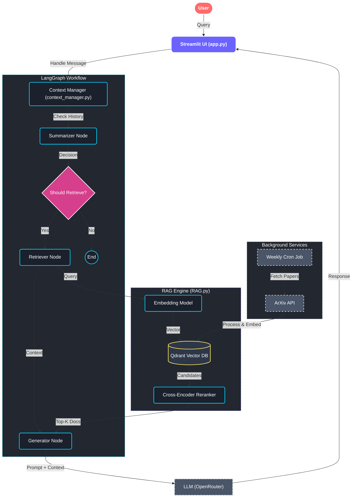

# ML Research RAG Chatbot

A premium, intelligent chatbot designed to answer questions about Machine Learning research papers. It leverages a robust **Retrieval-Augmented Generation (RAG)** pipeline to provide accurate, context-aware answers grounded in the latest academic literature.

**🚀 Deployed Application:** [https://mlresearch-rag.streamlit.app/](https://mlresearch-rag.streamlit.app/)

---

## 🏗️ High-Level Architecture

The system is built on a modular architecture separating the UI, orchestration, and core RAG logic.



---

## 🧩 Detailed Component Overview

### 1. Frontend & User Interface (`app.py` & `style.css`)
- **Framework:** Built with **Streamlit** for a responsive and interactive web application.
- **Design:** Features a **premium, glassmorphism-inspired UI** with:
    - Custom CSS for dark mode, smooth animations, and translucent elements.
    - Mobile-responsive layout ensuring a great experience on all devices.
    - Real-time streaming of LLM responses for a fluid conversational feel.
- **Functionality:**
    - Manages user sessions and chat history.
    - Displays LaTeX formulas correctly for mathematical explanations.
    - Provides a sidebar for triggering manual file ingestion.

### 2. Orchestration & Memory (`context_manager.py`)
- **LangGraph:** Uses a state machine to manage the conversation flow.
- **Smart Memory:**
    - **Short-term Memory:** Keeps the most recent messages for immediate context.
    - **Summarization:** Automatically condenses older parts of the conversation using an LLM to maintain long-term context without exceeding token limits.
- **Token Management:** Dynamically trims prompts and history to fit within the model's context window (default 3000 tokens).
- **Thread Management:** Assigns unique IDs to conversations for persistent state management.

### 3. Core RAG Logic (`RAG.py`)
- **Retrieval:**
    - **Embedding:** Defaults to `sentence-transformers/all-MiniLM-L6-v2`. After migrating the Qdrant data, it can use Google's local `google/embeddinggemma-2` model.
    - **Vector DB:** Queries **Qdrant** to find the most relevant document chunks.
- **Reranking:**
    - **Cross-Encoder:** Uses `cross-encoder/ms-marco-MiniLM-L-6-v2` to re-score the initial candidates. This step significantly improves accuracy by analyzing the deep semantic relationship between the query and the documents.
- **Generation:**
    - **LLM:** Connects to high-performance models (e.g., via OpenRouter) to generate answers.
    - **Citation System:** The system prompt enforces strict evidence-based answering, requiring inline citations (e.g., `[1]`) and a reference list of source files.

### 4. Data Ingestion
- **Automated Pipeline:** A weekly cron job fetches top trending ML papers from ArXiv.
- **Processing:** Papers are chunked, embedded, and stored in the Qdrant vector database.
- **Manual Trigger:** Users can request ingestion of specific files via the UI, which triggers a remote ingestion service.

---

## 🛠️ Setup & Installation

### Prerequisites
- Python 3.8+
- API Keys: OpenRouter, Qdrant

### Installation

1. **Clone the repository:**
   ```bash
   git clone https://github.com/your-repo/ml-research-rag.git
   cd ml-research-rag
   ```

2. **Install dependencies:**
   ```bash
   pip install -r requirements.txt
   ```

3. **Configure Environment Variables:**
   Create a `.env` file in the root directory:
   ```env
   QDRANT_URL=<your_qdrant_url>
   QDRANT_API_KEY=<your_qdrant_api_key>
   QDRANT_COLLECTION=document_chunks
   # Set these only after the migration is verified:
   # EMBEDDING_MODEL=google/embeddinggemma-2
   # QDRANT_COLLECTION_EG2=document_chunks_embeddinggemma2
   OPENROUTER_API_KEY=<your_openrouter_key>
   INGESTION_SERVICE_URL=<ingestion_service_url>
   ```

4. **Run the Application:**
   ```bash
   streamlit run app.py
   ```

---

## 📊 Performance & Configuration

| Parameter | Default | Description |
|-----------|---------|-------------|
| `retrieve_k` | 50 | Number of initial candidates fetched from Vector DB |
| `final_k` | 5 | Number of top documents kept after reranking |
| `token_budget` | 3000 | Maximum tokens allowed in the LLM prompt |
| `summary_threshold` | 8 | Number of messages before summarization triggers |

### EmbeddingGemma 2 migration

EmbeddingGemma 2 uses a different vector space from MiniLM. Existing Qdrant vectors must be regenerated; changing only the query model will make retrieval invalid. The included migration command writes to a separate collection, retains point IDs and payloads, checks the final point count, and never modifies or deletes the source collection.

1. Upgrade the project environment from this directory: `./ML_Research_RAG/bin/python -m pip install -r requirements.txt`.
2. Set `QDRANT_COLLECTION_EG2` to a new collection name if the default `<QDRANT_COLLECTION>_embeddinggemma2` is unsuitable.
3. Run `./ML_Research_RAG/bin/python migrate_embeddinggemma2.py` and wait for the final verified count. The migration requires each source point to have a non-empty `text` payload and an unnamed dense vector collection. If interrupted, rerun with `--resume`; it skips destination points whose IDs, payloads, and vector shape are already valid, then verifies the exact source/destination ID sets. The source remains untouched.
4. After validating retrieval, set `EMBEDDING_MODEL=google/embeddinggemma-2` in the app environment. This selects the new collection. Keep the existing `QDRANT_COLLECTION` unchanged as the rollback path.

To run the migration from GitHub Actions, use the hosted `macos-latest-xlarge` runner (Apple Silicon M2 with GPU acceleration; larger-runner availability and billing apply). Add `QDRANT_URL` as a repository secret; add `QDRANT_API_KEY` if the Qdrant endpoint requires it. The workflow defaults to `document_chunks` as the source collection and `document_chunks_embeddinggemma2` as the destination. Then dispatch **Migrate Qdrant to EmbeddingGemma 2** from the Actions tab. The workflow uses the `ML_Research_RAG` virtual environment, and automatically starts a second hosted job to resume if the first hits its six-hour limit. Do not dispatch it while another migration is writing to that destination.

The app uses the model's text and code encoder and 256-dimensional normalized vectors to reduce Qdrant storage and search work. Queries use the `SearchQuery` prompt and corpus chunks use `Document`, as required for asymmetric retrieval. The original MiniLM collection remains available. The separate ingestion service must also write new documents with EmbeddingGemma 2 before switching the app, or newly ingested papers will not appear in the new collection. The venv needs sentence-transformers 6.1 or later for this model; that release line conflicts with the `docling`/`datasets` dependency versions currently present in the same venv, so check `pip check` before using the upgraded environment for other ingestion work.

### Retrieval evaluation

Precision and recall require relevance labels; vector similarity scores alone cannot provide them. Create a UTF-8 JSONL file with one query per line and the relevant Qdrant `_stable_id` values, then run:

```bash
cat > labeled_queries.jsonl <<'EOF'
{"query":"What is U-Net?","relevant_ids":["exact_stable_chunk_id_1","exact_stable_chunk_id_2"]}
EOF
./ML_Research_RAG/bin/python evaluate_retrieval.py labeled_queries.jsonl --only minilm
```

Replace the example IDs with judged relevant chunk IDs. After migration, run the same dataset with `--only eg2` (or omit `--only` to run both). The evaluator reports candidate Recall@50 and Precision@50, reranked Recall@5 and Precision@5, and mean/median/p95 latency split across embedding, Qdrant search, and reranking. It only reads the collections. For a meaningful comparison, label at least 50 representative questions and pool relevant IDs across both models' top results before scoring.

---

## 🔄 Data Flow Summary

1. **User Input:** The user asks a question in the Streamlit UI.
2. **Context Check:** `ContextManager` loads the conversation history.
3. **Retrieval:** `RAG.py` converts the query to a vector and searches Qdrant.
4. **Refinement:** The Cross-Encoder reranks the results to find the best matches.
5. **Prompting:** A prompt is built with the system instructions, history, and top context chunks.
6. **Generation:** The LLM generates a streamed response with citations.
7. **Display:** The answer is shown to the user, and the conversation state is updated.
